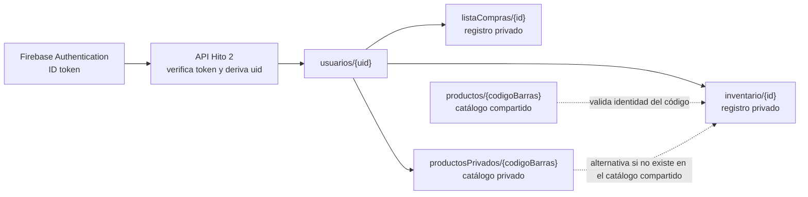

# Modelo de datos del backend — Hito 2

FrescApp usa Cloud Firestore, una base de datos documental. Las colecciones se crean al guardar su primer documento; no hay tablas SQL que crear. El esquema se aplica en la API y se protege además con las reglas ya existentes para los clientes de la aplicación.

## Colecciones

| Ruta | Propietario | Campos principales | Tipos |
|---|---|---|---|
| `usuarios/{uid}/inventario/{id}` | Cuenta autenticada indicada por el token | `codigoBarras`, `nombre`, `marca`, `categoria`, `formato`, `unidad`, `cantidad`, `vencimiento`, `fechaRegistro`, `creadoEn`, `ubicacion`, `abiertoEn` | texto, número, timestamp; `abiertoEn` es opcional |
| `usuarios/{uid}/listaCompras/{id}` | Cuenta autenticada indicada por el token | `nombre`, `cantidad`, `unidad`, `comprado`, `creadoEn`, `actualizadoEn` | texto, número, booleano, timestamp |
| `usuarios/{uid}/productosPrivados/{codigoBarras}` | Cuenta autenticada indicada por el token | `codigoBarras`, `nombre`, `marca`, `categoria`, `formato`, `unidad`, `activo` | texto y booleano |
| `productos/{codigoBarras}` | Catálogo compartido, solo administración | `codigoBarras`, `nombre`, `marca`, `categoria`, `formato`, `unidad`, `activo` | texto y booleano |

## Diagrama del modelo

El diagrama muestra rutas de documentos y la validación de identidad del producto. Firestore es documental: las líneas no representan claves foráneas. La API usa el `uid` verificado para limitar cada operación a los datos de esa cuenta.

`uid` se obtiene del ID token verificado por Firebase Authentication; nunca se acepta desde el cuerpo ni desde la URL. Los registros existentes en la colección histórica superior `inventario/{id}` siguen siendo administrados por el flujo antiguo de la aplicación y no forman parte de las nuevas rutas REST.

## Restricciones

- Categorías: `Lacteos`, `Carnes`, `Frutas`, `Verduras`, `Despensa`, `Bebidas`, `Congelados`, `Snacks`, `Otros`.
- Ubicaciones: `Despensa`, `Refrigerador`, `Congelador`.
- Unidades de compra: `unidad`, `kg`, `g`, `L`.
- Cantidades mayores que cero y hasta 999; la unidad de compra se expresa como entero.
- El vencimiento acepta `DD/MM/AAAA`, `MM/AAAA` o `Sin fecha`.
- La API asigna IDs y marcas de tiempo de creación/actualización; no confía en esos valores del cliente.
- El inventario usa el catálogo común activo o `usuarios/{uid}/productosPrivados` para validar la identidad del código de barras. Los productos genéricos con prefijo `sin:` se validan contra una lista local fija.

## Inicialización reproducible

Firestore es schemaless: la configuración se reproduce iniciando los emuladores con el proyecto de demostración, publicando reglas e índices desde `firebase.json` y ejecutando `node db/crear-estructura-hito2.cjs --uid UID_DE_PRUEBA`. El script se bloquea si no detecta el emulador local y un ID de proyecto `demo-*`; nunca inicializa datos en producción. Crea datos sintéticos de inventario, lista de compras y el producto necesario para demostrar el POST de inventario.
